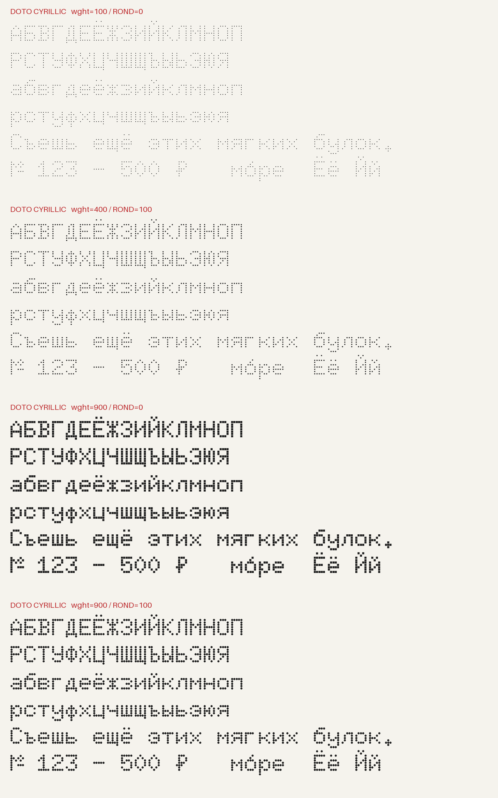

# Doto Cyrillic — русский язык

Independent Russian-language extension of [Doto by the Doto Project Authors](https://github.com/oliverlalan/Doto), based on upstream commit `1c587f2eed62cb257055540ac2a15f356070414f`.

**Download the fonts from [`fonts/cyrillic`](fonts/cyrillic).** The original `fonts/ttf`, `fonts/variable` and `fonts/webfonts` directories are retained for upstream history and contain Latin-only upstream builds.

## Что добавлено

- Все 33 прописные и 33 строчные буквы русского алфавита, включая Ё/ё и Й/й; № и ₽ — 68 новых кодовых позиций.
- Исходные UFO для всех четырёх мастеров: Thin/Black × Square/Round.
- Обе оси: `wght` 100–900, `ROND` 0–100 (с исходным нелинейным отображением).
- Моноширинные буквы по 600 единиц, русское позиционирование комбинируемых ударений, нулевая ширина U+0300/U+0301/U+0306/U+0308.
- Отдельное имя семейства **Doto Cyrillic** для установки рядом с оригиналом.

Это покрытие русского языка, а не всего блока Unicode Cyrillic и не всех славянских языков. Курсив и другие локализованные формы не добавлены. Doto — акцидентный шрифт для крупных надписей и виджетов; для длинного мелкого текста стоит выбрать обычный текстовый шрифт.

## Скачать и установить

В [`fonts/cyrillic`](fonts/cyrillic) находятся:

| Файл | Назначение |
| --- | --- |
| `DotoCyrillic[ROND,wght].ttf` | Вариативный шрифт для рабочего стола |
| `DotoCyrillic-Regular.ttf` | Обычное начертание, `wght=400`, `ROND=0` |
| Соответствующие `.woff2` | Веб-версии обоих файлов |

В GNOME откройте TTF в просмотрщике шрифтов и нажмите «Установить». В приложении выберите семейство **Doto Cyrillic**. Устанавливайте либо вариативный TTF, либо Regular TTF: одновременно они могут показывать совпадающее начертание Regular. Системные настройки и расширения GNOME этот проект не меняет.

## Сборка из исходников

Проверенное окружение: CPython 3.14; версии всех зависимостей зафиксированы в `requirements-build.txt`.

```sh
python3.14 -m venv .venv
. .venv/bin/activate
python -m pip install -r requirements-build.txt
python scripts/build.py
python -m pytest tests -q
python scripts/specimen.py
```

Результат сборки — четыре файла в `fonts/cyrillic`. Скрипт сначала воспроизводит кириллические GLIF во всех UFO, затем собирает вариативный TrueType из `sources/Doto.designspace`, формирует STAT, имена производного семейства, статический Regular и WOFF2. `SOURCE_DATE_EPOCH` задаётся по умолчанию; его можно переопределить при сборке. Генератор идемпотентен: повторный запуск не меняет исходники.

Рисунки новых букв заданы читаемыми рядами битовой сетки в [`scripts/add_cyrillic.py`](scripts/add_cyrillic.py). Каждая точка использует исходный контур точки своего мастера. Совпадающие по рисунку латинские и кириллические буквы используют исходные латинские контуры. Геометрия остальных русских букв нарисована отдельно, включая строчную к без латинского верхнего выносного элемента.

## Проверки

17 проверок pytest включают:

- независимый список из 66 русских букв и двух знаков во всех четырёх бинарных файлах;
- ненулевые контуры, границы, моноширинность и метаданные лицензии;
- совместимость четырёх исходных мастеров и повторную генерацию;
- интерполяцию и HarfBuzz shaping в девяти точках пространства осей;
- русскую панграмму, NFD-последовательности Ё/ё/Й/й и позиционирование ударения;
- сохранение исходных контуров всех 1276 upstream GLIF по независимому контрольному списку.

Проверки запускаются в [GitHub Actions](../../actions). PNG ниже строится из собранного TTF без подстановки системных шрифтов. Локальная проверка не заменяет проверку конкретного виджета или приложения GNOME.



## Лицензия и авторство

Исходник и производный шрифт распространяются по [SIL Open Font License 1.1](OFL.txt). Исходные `OFL.txt`, `AUTHORS.txt` и `CONTRIBUTORS.txt` сохранены. В copyright-заголовке upstream OFL не объявлены Reserved Font Names. Семейство всё равно переименовано в Doto Cyrillic, чтобы различать сборки. Модификация не означает одобрения со стороны исходных авторов.

При распространении сохраняйте copyright и полный OFL. Шрифт нельзя продавать сам по себе; включение в программные продукты разрешено на условиях OFL. Подробнее: [официальные разъяснения OFL](https://openfontlicense.org/ofl-faq/).

См. [`FONTLOG.md`](FONTLOG.md) для происхождения и границ изменений.
